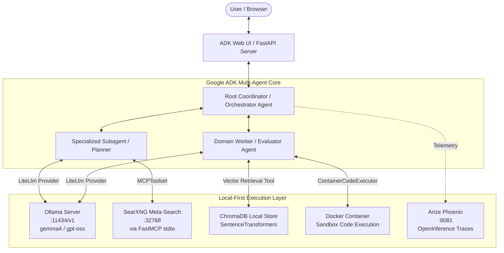

# Local Google ADK Samples (`ollama-adk-samples`)

[](https://www.python.org/downloads/)
[](https://github.com/astral-sh/uv)
[](https://github.com/google/adk-python)
[](https://ollama.com)
[](https://docs.searxng.org/)
[](LICENSE)

A collection of local-first rewrites of the official Python agent samples from [google/adk-recipes](https://github.com/google/adk-recipes). These projects demonstrate how to build, orchestrate, evaluate, and deploy autonomous multi-agent systems using the **Google Agent Development Kit (ADK)** while running **100% locally and privately**.

All cloud dependencies (Gemini APIs, Vertex AI Vector Search, Google Grounding Search, and cloud sandboxes) have been substituted with local open-source counterparts:
- **LLM Inference:** [Ollama](https://ollama.com) via ADK's [`LiteLlm`](https://docs.litellm.ai/) provider (`gemma4:26b`, `gemma4:31b`, `gpt-oss:20b`).
- **Web Search & Grounding:** Local [SearXNG](https://docs.searxng.org/) instances queried via the [Model Context Protocol (MCP)](https://modelcontextprotocol.io/) (`searxng_mcp`) or asynchronous HTTP connectors.
- **Vector Storage & Retrieval:** Local [ChromaDB](https://www.trychroma.com/) with Hugging Face `SentenceTransformers` (`all-MiniLM-L6-v2`).
- **Code Execution:** Dockerized sandboxes via `ContainerCodeExecutor` or local isolation executors.
- **Observability & Tracing:** Local [Arize Phoenix](https://phoenix.arize.com/) instance via OpenInference instrumentation.

---

## 🏛 Local Architecture Overview



### Key Differences from Upstream `google/adk-recipes`

| Component | Upstream `google/adk-recipes` | Local Rewrite (`ollama-adk-samples`) |
| :--- | :--- | :--- |
| **Model Runtime** | Google Gemini 1.5/2.0 via Vertex AI / Google GenAI Studio | Local Ollama running `gemma4:26b`, `gemma4:31b`, or `gpt-oss:20b` via `LiteLlm` |
| **Search Engine** | Google Search Grounding (`google-genai` tools) | Self-hosted SearXNG via Model Context Protocol (FastMCP stdio) |
| **Vector DB** | Vertex AI Vector Search / Cloud Datastore | Local persistent ChromaDB with `all-MiniLM-L6-v2` embeddings |
| **Document Parsing** | Cloud Document AI / Gemini Multimodal Input | Local PDF parsing (`pypdf`) via ADK `before_model_callback` hooks |
| **Code Execution** | Vertex AI Code Execution Sandbox | Local Docker container sandboxes (`ContainerCodeExecutor`) |
| **Telemetry** | Google Cloud Trace / Logging | Local Arize Phoenix UI via OpenInference telemetry |

---

## 📂 Projects Catalog

| Subdirectory | Upstream Recipe | Primary Architecture | Key Local Substitution | Launch Command |
| :--- | :--- | :--- | :--- | :--- |
| [**`RAG/`**](file:///Users/dan/Code/delme/ollama-adk-samples/RAG) | `RAG` | Single-agent Document Q&A with strict citations | Local ChromaDB + SentenceTransformers | `uv run adk web RAG/rag_agent` |
| [**`academic_research/`**](file:///Users/dan/Code/delme/ollama-adk-samples/academic_research) | `academic_research` | Hierarchical Multi-Agent (Coordinator, Search, Synthesis) | PDF text hook (`pypdf`) + SearXNG MCP | `uv run adk web academic_research` |
| [**`agent_skills_tutorial/`**](file:///Users/dan/Code/delme/ollama-adk-samples/agent_skills_tutorial) | `agent_skills_tutorial` | Progressive Disclosure with `SkillToolset` | Local `gemma4:26b` running 4 skill patterns | `uv run adk web agent_skills_tutorial` |
| [**`coder_agents/`**](file:///Users/dan/Code/delme/ollama-adk-samples/coder_agents) | `coder_agents` | Multi-strategy code generation & execution | Dockerized sandbox (`ContainerCodeExecutor`) | `uv run adk web coder_agents` |
| [**`deep_search/`**](file:///Users/dan/Code/delme/ollama-adk-samples/deep_search) | `deep_search` | Sequential & Loop Agent research pipeline | SearXNG MCP + Custom Vite/React UI | Backend: `adk api_server`<br>Frontend: `npm run dev` |
| [**`financial_advisor/`**](file:///Users/dan/Code/delme/ollama-adk-samples/financial_advisor) | `financial_advisor` | Hierarchical Multi-Agent (4 expert financial analysts) | Local SearXNG HTTP connector + Ollama | `uv run adk web financial_advisor` |
| [**`searxng_search/`**](file:///Users/dan/Code/delme/ollama-adk-samples/searxng_search) | Grounding Search | FastMCP server & client connector | Local SearXNG instance on `:32768` | `uv run adk web searxng_search` |
| [**`youtube_analyst/`**](file:///Users/dan/Code/delme/ollama-adk-samples/youtube_analyst) | `youtube_analyst` | Multi-Agent + Dynamic Plotly/Matplotlib visualization | `WebSafeLiteLlm` wrapper + local chart generation | `uv run adk web youtube_analyst` |

---

## 🔍 Detailed Project Summaries

### 1. [RAG (Retrieval-Augmented Generation)](file:///Users/dan/Code/delme/ollama-adk-samples/RAG)

An accurate, verifiable document question-answering agent designed for complex documents (such as financial 10-K filings).
- **Core Components:**
  - Ingestion pipeline ([`load-data.ipynb`](file:///Users/dan/Code/delme/ollama-adk-samples/RAG/notebooks/load-data.ipynb)): Parses PDFs page-by-page using `pypdf` and `langchain_text_splitters.RecursiveCharacterTextSplitter`. Generates embeddings using `sentence-transformers/all-MiniLM-L6-v2` and persists them to a local [`chroma_db_chunks/`](file:///Users/dan/Code/delme/ollama-adk-samples/RAG/chroma_db_chunks) database with rich metadata (page numbers, source filenames, character offsets).
  - Agent ([`rag_agent/agent.py`](file:///Users/dan/Code/delme/ollama-adk-samples/RAG/rag_agent/agent.py)): Configures `ask_rag_agent` on `LiteLlm(model="openai/gpt-oss:20b")` with the [`ask_chromadb`](file:///Users/dan/Code/delme/ollama-adk-samples/RAG/rag_agent/tools.py) tool.
  - Evaluation ([`eval/test_eval_phoenix.py`](file:///Users/dan/Code/delme/ollama-adk-samples/RAG/eval/test_eval_phoenix.py)): Automated local evaluation suite benchmarking retrieval precision and groundedness using Arize Phoenix and OpenInference.
- **Run Command:**
  ```bash
  uv run adk web RAG/rag_agent
  ```

---

### 2. [Academic Research](file:///Users/dan/Code/delme/ollama-adk-samples/academic_research)

An autonomous literature analysis workflow that ingests a seminal research paper, searches for recent citing literature, and synthesizes novel future research directions.
- **Multi-Agent Hierarchy:**
  - [`academic_coordinator`](file:///Users/dan/Code/delme/ollama-adk-samples/academic_research/acedemic_research/agent.py): Root orchestrator. Intercepts PDF uploads via an ADK `before_model_callback` hook ([`callbacks.py`](file:///Users/dan/Code/delme/ollama-adk-samples/academic_research/acedemic_research/callbacks.py)) that parses PDF binary data into plain text dynamically before it reaches the model.
  - [`academic_websearch_agent`](file:///Users/dan/Code/delme/ollama-adk-samples/academic_research/acedemic_research/sub_agents/academic_websearch/agent.py): Queries local SearXNG via FastMCP (`searxng_mcp`) for recent citing publications published within the last 1–2 years.
  - [`academic_newresearch_agent`](file:///Users/dan/Code/delme/ollama-adk-samples/academic_research/acedemic_research/sub_agents/academic_newresearch/agent.py): Formulates novel, high-utility research proposals combining insights from the seminal paper and recent developments.
- **Run Command:**
  ```bash
  uv run adk web academic_research
  ```

---

### 3. [Agent Skills Tutorial](file:///Users/dan/Code/delme/ollama-adk-samples/agent_skills_tutorial)

Demonstrates Google ADK's `SkillToolset` pattern, enabling agents to dynamically discover, load, and execute specialized capabilities on demand without bloating the core system prompt.
- **The 4 Skill Implementations:**
  1. **Inline Skill (`seo-checklist`):** Programmatic Python-defined rules directly inside code.
  2. **File-Based Skill (`blog-writer`):** Loaded from local directories containing standard `SKILL.md` instruction files and templates.
  3. **External Skill (`content-research-writer`):** Simulates third-party community-contributed skills.
  4. **Meta Skill (`skill-creator`):** Self-extending capability allowing the agent to read specification guidelines and generate new `SKILL.md` skill packages dynamically.
- **Run Command:**
  ```bash
  uv run adk web agent_skills_tutorial
  ```

---

### 4. [Coder Agents](file:///Users/dan/Code/delme/ollama-adk-samples/coder_agents)

A comparative implementation of four different code execution and sandboxing strategies for code-generation agents:
- **Sub-Agents:**
  - [`unsafe_agent/`](file:///Users/dan/Code/delme/ollama-adk-samples/coder_agents/unsafe_agent): Direct in-process execution using `UnsafeLocalCodeExecutor` (no sandboxing).
  - [`w_tools_agent/`](file:///Users/dan/Code/delme/ollama-adk-samples/coder_agents/w_tools_agent): Custom tool executing code via Python's `exec()` (no isolation).
  - [`container_agent/`](file:///Users/dan/Code/delme/ollama-adk-samples/coder_agents/container_agent): Isolated container execution using `ContainerCodeExecutor` with standard `python:3.11-slim`.
  - [`sandbox_agent/`](file:///Users/dan/Code/delme/ollama-adk-samples/coder_agents/sandbox_agent): Full Docker sandbox using a customized `docker-sandbox` image equipped with scientific computing libraries (`pandas`, `numpy`, `scipy`).
- **Run Command:**
  ```bash
  uv run adk web coder_agents
  ```
  *(Select any of the 4 agents via the UI dropdown).*

---

### 5. [Deep Search](file:///Users/dan/Code/delme/ollama-adk-samples/deep_search)

An advanced, iterative multi-agent research and report composition system featuring a full-stack architecture with a dedicated FastAPI backend and a custom React + Vite frontend.
- **Pipeline Architecture:**
  - [`interactive_planner_agent`](file:///Users/dan/Code/delme/ollama-adk-samples/deep_search/backend/app/agent.py): Root agent that interacts with the user to negotiate and refine a structured research plan.
  - [`research_pipeline`](file:///Users/dan/Code/delme/ollama-adk-samples/deep_search/backend/app/agent.py) (`SequentialAgent`):
    - `section_planner`: Breaks the research plan into report sections.
    - `section_researcher`: Conducts initial deep searches using SearXNG FastMCP.
    - `iterative_refinement_loop` (`LoopAgent`): Repeatedly executes `research_evaluator` (critic agent) and `enhanced_search_executor`, controlled by a custom `EscalationChecker` agent that terminates the loop upon reaching passing quality.
    - `report_composer_with_citations`: Synthesizes research notes into a publication-grade markdown report with automatic citation replacement.
- **Frontend & Backend Run:**
  ```bash
  # Terminal 1 - Backend API Server:
  cd deep_search/backend
  uv run adk api_server . --allow_origins="*"

  # Terminal 2 - Vite React Frontend:
  cd deep_search/frontend
  npm run dev
  ```

---

### 6. [Financial Advisor](file:///Users/dan/Code/delme/ollama-adk-samples/financial_advisor)

A hierarchical multi-agent advisory assistant that coordinates a team of specialized financial analysts to guide users through structured stock analysis, trading strategy, and risk assessment.
- **Specialized Subagents:**
  - [`data_analyst`](file:///Users/dan/Code/delme/ollama-adk-samples/financial_advisor/financial_advisor/sub_agents/data_analyst): Queries ticker metrics and financial news via an asynchronous [`SearXNGConnector`](file:///Users/dan/Code/delme/ollama-adk-samples/financial_advisor/financial_advisor/sub_agents/data_analyst/tools.py).
  - [`trading_analyst`](file:///Users/dan/Code/delme/ollama-adk-samples/financial_advisor/financial_advisor/sub_agents/trading_analyst): Formulates trading strategies aligned with user risk preferences and investment horizons.
  - [`execution_analyst`](file:///Users/dan/Code/delme/ollama-adk-samples/financial_advisor/financial_advisor/sub_agents/execution_analyst): Specifies order execution tactics, timing, and fee/slippage management.
  - [`risk_analyst`](file:///Users/dan/Code/delme/ollama-adk-samples/financial_advisor/financial_advisor/sub_agents/risk_analyst): Assesses portfolio vulnerabilities, drawdown risks, and volatility boundaries.
- **Run Command:**
  ```bash
  uv run adk web financial_advisor
  ```

---

### 7. [SearXNG Search Agent](file:///Users/dan/Code/delme/ollama-adk-samples/searxng_search)

The reference implementation and foundational connector for local search across the repository.
- **Components:**
  - FastMCP Server ([`searxng_mcp/server.py`](file:///Users/dan/Code/delme/ollama-adk-samples/searxng_search/searxng_mcp/server.py)): Wraps a local SearXNG engine instance into an MCP standard search tool over stdio transport.
  - Search Connector ([`searxng_mcp/connector.py`](file:///Users/dan/Code/delme/ollama-adk-samples/searxng_search/searxng_mcp/connector.py)): Asynchronous client connecting to `http://localhost:32768` (configurable).
  - Search Agent ([`searxng_search_agent/agent.py`](file:///Users/dan/Code/delme/ollama-adk-samples/searxng_search/searxng_search_agent/agent.py)): An ADK agent equipped with `MCPToolset` to test queries and verify search grounding.
  - Documentation ([`SearXng_How-to-setup.pdf`](file:///Users/dan/Code/delme/ollama-adk-samples/searxng_search/SearXng_How-to-setup.pdf)): Step-by-step setup guide for SearXNG.
- **Run Command:**
  ```bash
  uv run adk web searxng_search
  ```

---

### 8. [YouTube Analyst ("YouBuddy")](file:///Users/dan/Code/delme/ollama-adk-samples/youtube_analyst)

An AI-native "Attention Guardian" and consultative YouTube analysis agent focused on Return on Attention (RoA).
- **Core Features:**
  - YouTube Data Integration ([`tools.py`](file:///Users/dan/Code/delme/ollama-adk-samples/youtube_analyst/youtube_analyst/tools.py)): Direct retrieval of video transcripts (`youtube-transcript-api`), video metadata, comments, and channel statistics.
  - Data Visualization Subagent ([`visualization_agent`](file:///Users/dan/Code/delme/ollama-adk-samples/youtube_analyst/youtube_analyst/sub_agents/visualization/agent.py)): Dynamically executes Python code to produce interactive HTML charts (Plotly) and static graphics (Matplotlib).
  - Dynamic Skills: Includes skills for KOL discovery (`kol-discovery`), audience sentiment analysis (`sentiment-analysis`), and debate synthesis (`debate-synthesizer`).
  - Web UI Compatibility: Uses [`WebSafeLiteLlm`](file:///Users/dan/Code/delme/ollama-adk-samples/youtube_analyst/youtube_analyst/config.py) to prevent FastAPI schema serialization conflicts with `LiteLlm` internal objects.
- **Run Command:**
  ```bash
  export YOUTUBE_SEARCH_API="your-youtube-api-key"
  uv run adk web youtube_analyst
  ```

---

## 🛠 Local Environment & Services Setup

### 1. Prerequisites
- **Python:** `>=3.14` (managed via `uv`)
- **Package Manager:** [`uv`](https://docs.astral.sh/uv/)
- **Ollama:** [Installed and running](https://ollama.com) on `http://localhost:11434`
- **Docker:** (Required for `coder_agents` container sandboxes and SearXNG)

### 2. Pull Required Ollama Models
Ensure you have the required open models pulled to your local Ollama daemon:
```bash
# General purpose and skills agents
ollama pull gemma4:26b

# Deep reasoning and synthesis agents
ollama pull gemma4:31b

# RAG and Deep Search agents
ollama pull gpt-oss:20b
```

### 3. Start Local SearXNG Instance
Run SearXNG locally using Docker (configured to listen on port `32768` by default):
```bash
docker run -d \
  --name searxng \
  -p 32768:8080 \
  -v "${PWD}/searxng:/etc/searxng" \
  -e "SEARXNG_BASE_URL=http://localhost:32768/" \
  searxng/searxng:latest
```

### 4. Install Dependencies
Initialize the virtual environment and install all project dependencies using `uv`:
```bash
make dev
# or equivalently:
uv sync --extra dev --prerelease allow
```

### 5. Apply the OpenInference Instrumentation Hot-Patch
> [!IMPORTANT]
> The upstream package `openinference-instrumentation-google-adk` contains a bug when parsing `google-adk` prerelease version strings (e.g. `2.0.0a3`), causing crashes during `adk web` startup.
> Run our automated patch script whenever you rebuild or refresh your `.venv`:
```bash
uv run python patch_openinference.py
```
*(See [`README-HOTPATCH.md`](file:///Users/dan/Code/delme/ollama-adk-samples/README-HOTPATCH.md) for full technical details).*

---

## 📊 Local Observability & Tracing

All agents support full telemetry tracing into a local [Arize Phoenix](https://phoenix.arize.com/) server.

1. **Launch Phoenix UI:**
   ```bash
   make phoenix
   # or:
   PHOENIX_HOST=127.0.0.1 PHOENIX_PORT=8081 uv run phoenix serve
   ```
2. **Access the Dashboard:** Open `http://127.0.0.1:8081` in your browser to inspect agent tool calls, step latencies, token consumption, and intermediate thinking traces.

---

## 💻 Development & Automation Commands

This repository includes a [`Makefile`](file:///Users/dan/Code/delme/ollama-adk-samples/Makefile) for standard tasks:

| Command | Action |
| :--- | :--- |
| `make dev` | Bootstraps `.venv` dependencies via `uv sync --extra dev --prerelease allow`. |
| `make phoenix` | Starts local Arize Phoenix tracing server on `http://127.0.0.1:8081`. |
| `make lint` | Runs `ruff format`, `ruff check`, and `mypy` type validations. |
| `uv run adk web <dir>` | Launches the interactive Google ADK Web UI for the given project. |
| `uv run python patch_openinference.py` | Hot-patches `.venv` openinference package for `google-adk` prereleases. |

---

## 📜 Attribution & License

- Original recipes and agent concepts adapted from Google's [google/adk-recipes](https://github.com/google/adk-recipes).
- Distributed under the [Apache License 2.0](LICENSE).
